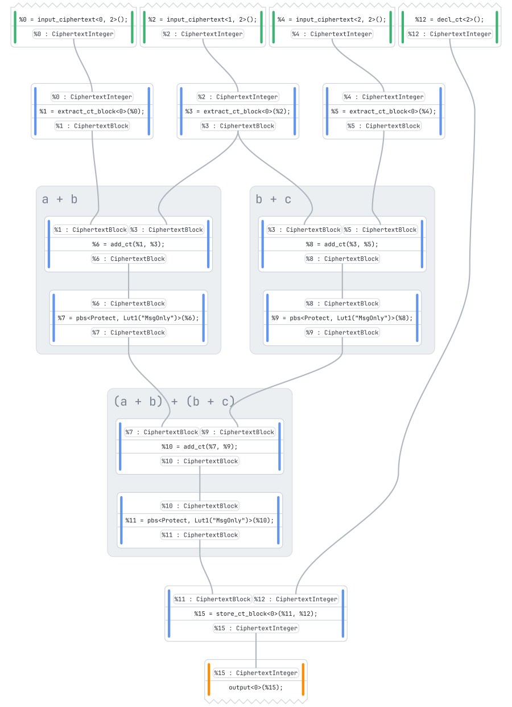
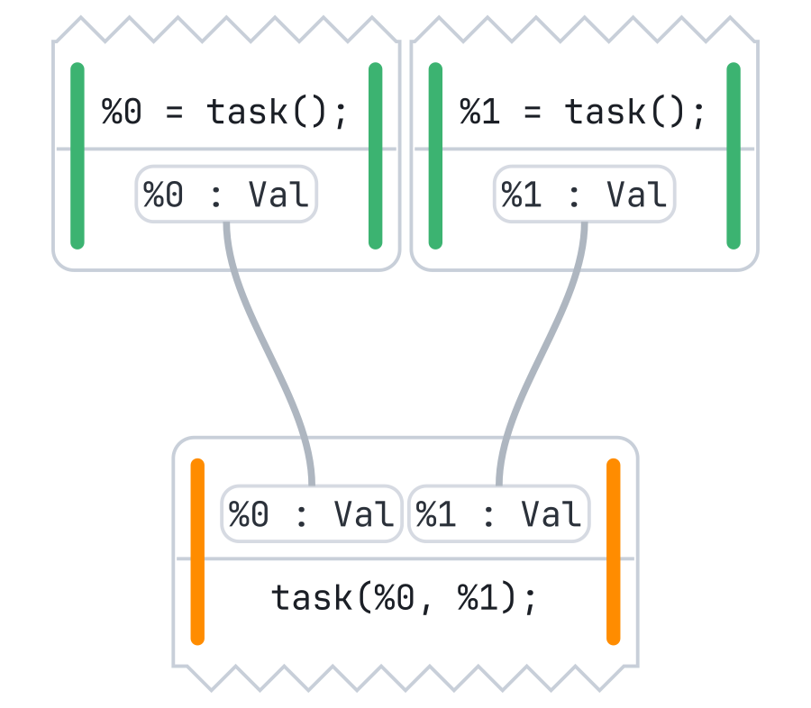
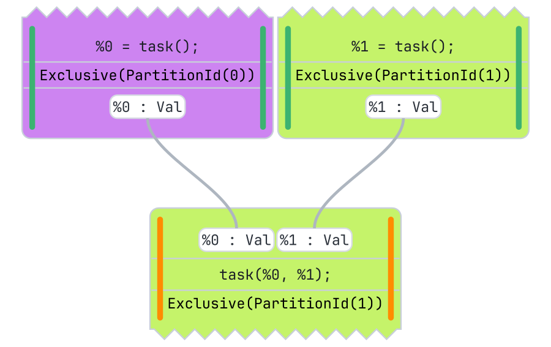
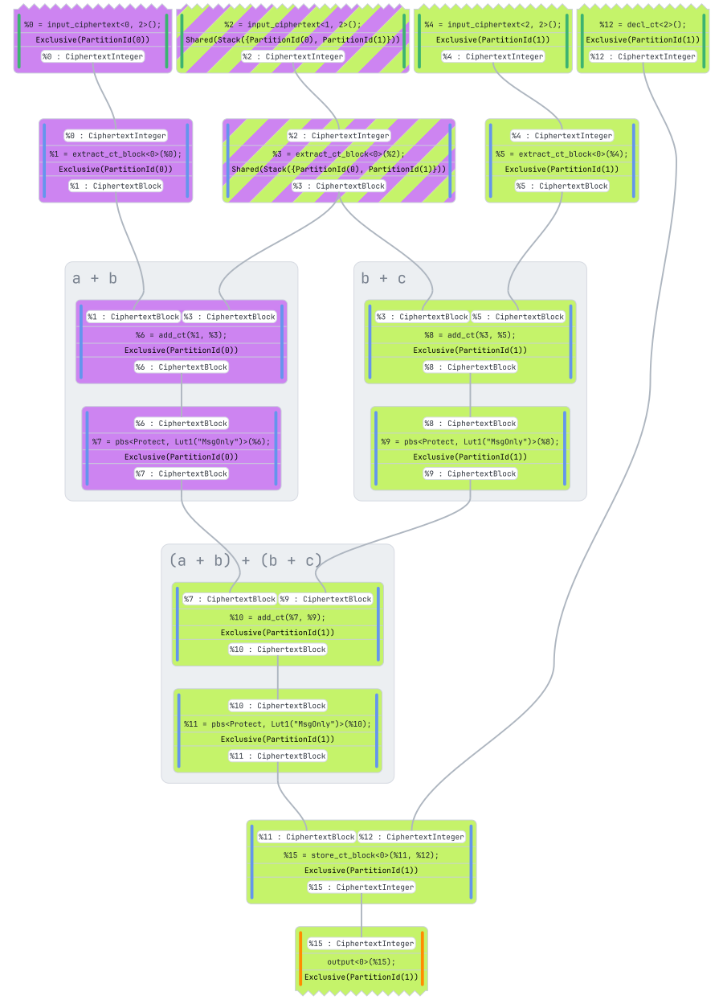
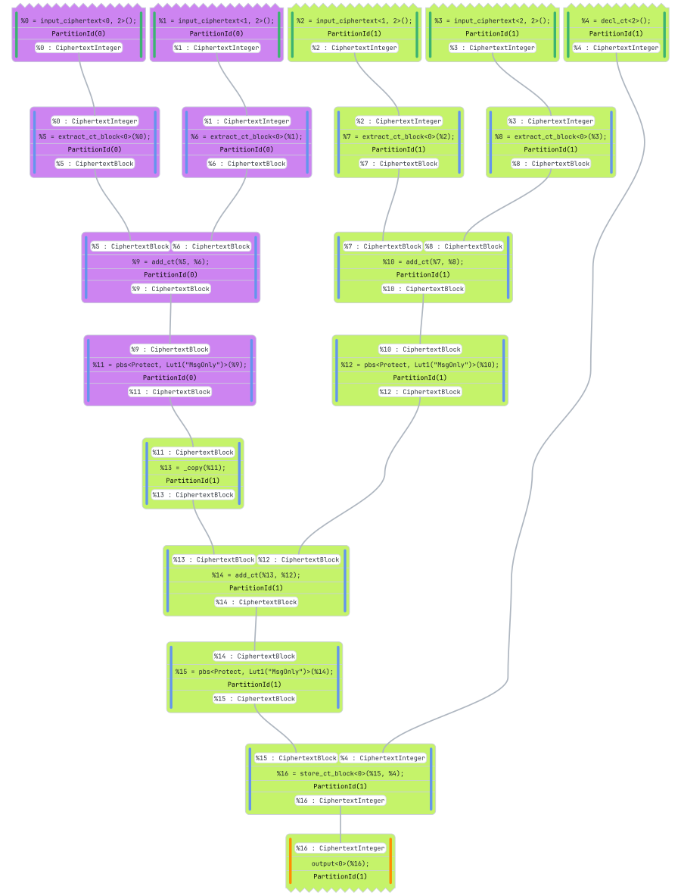
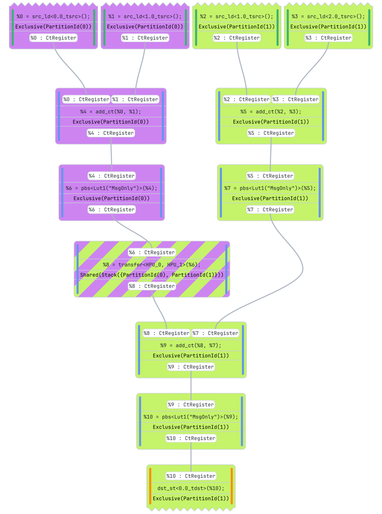
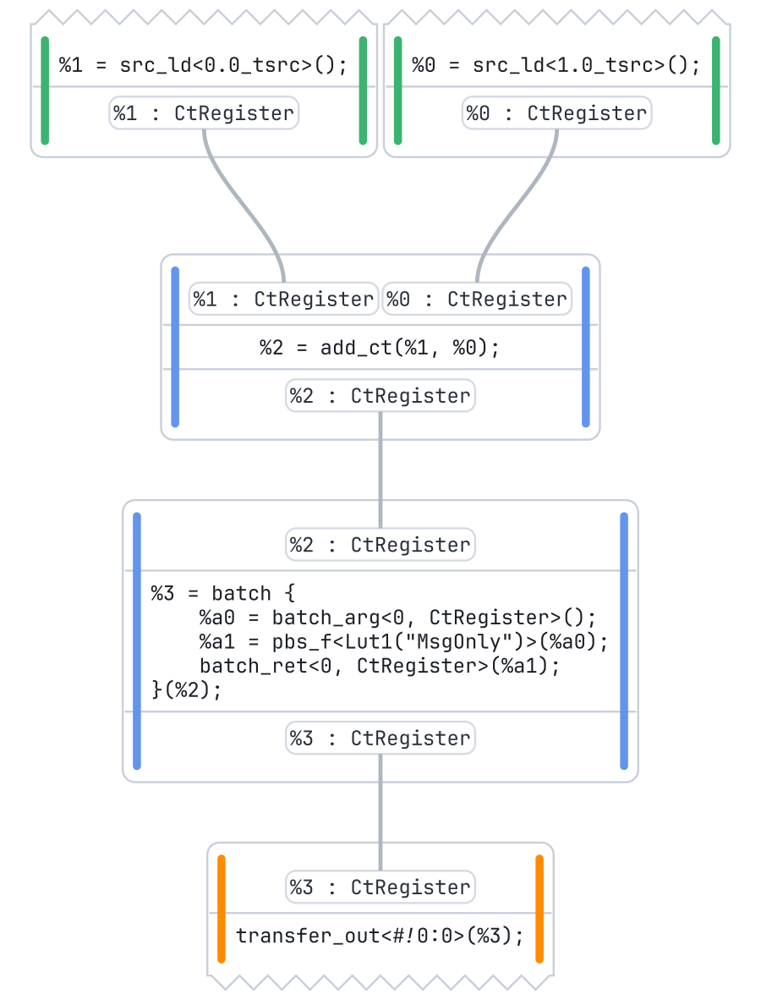
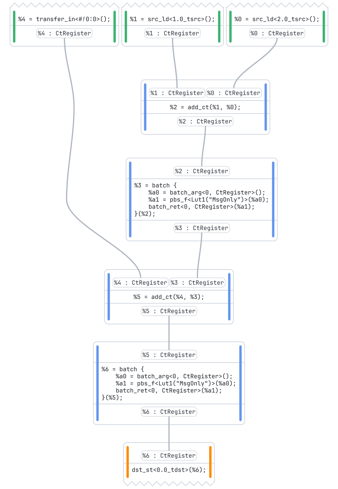
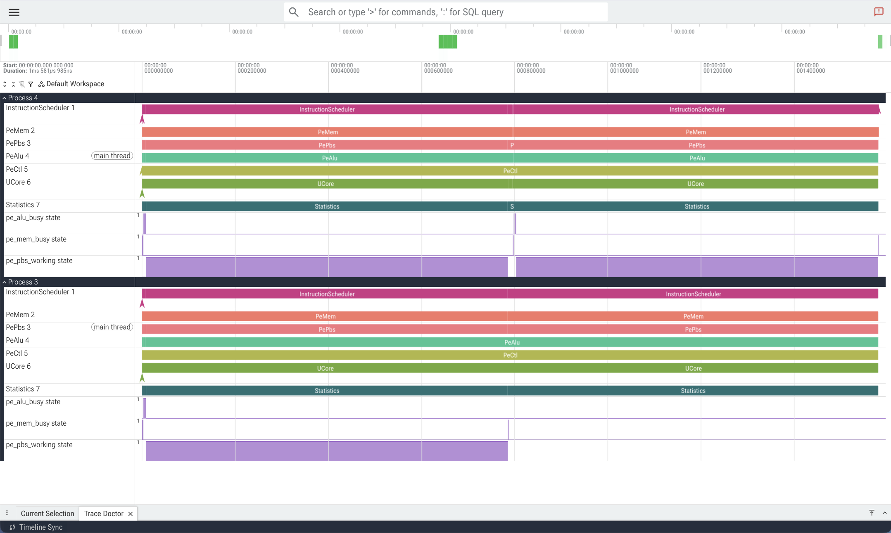

# Partitioning

Interconnecting HPUs into a cluster brings more compute power to a circuit, but raises a new question: which board should run which operation? Answering it by hand is tedious, brittle, and must be redone for every circuit and every cluster size. Since v0.11.0, ZHC answers it automatically: the multi-HPU flow __partitions__ the circuit over the boards, inserts the transfers it needs, and emits one instruction stream per HPU.

This page follows a small circuit through the whole process. Every drawing comes from the [`auto_partitioning`](../zhc/examples/auto_partitioning.rs) example, which can be run with:

```shell
cargo run --release -p zhc --example auto_partitioning
```

## The Circuit



The example computes `(a + b) + (b + c)` over three 2-bit integers. With 2 bits of message per block, every integer fits in a single block, and each addition boils down to a linear `add_ct` followed by a PBS clearing the carry:

```rust
use zhc::prelude::*;

fn add(bd: &Builder, lhs: CiphertextBlock, rhs: CiphertextBlock) -> CiphertextBlock {
    let sum = bd.block_add(lhs, rhs);
    bd.block_lookup(sum, Lut1::msg_only(*bd.spec()))
}

let ab =  add(&bd.comment("a + b"), a, b);
let bc =  add(&bd.comment("b + c"), b, c);
let sum = add(&bd.comment("(a + b) + (b + c)"), ab, bc);
```

Small as it is, this circuit exercises everything the partitioner has to deal with. The two first additions are independent and can run side by side on two boards. The last one needs both of their results, so one of them has to travel. And input `b` feeds both first additions, so both boards need it.

The circuit is compiled for 2 HPUs. To make the split visible at this scale, the example restricts each HPU to a single PBS per batch.

<br clear="right">

## Coarsening



In FHE, a PBS costs hundreds to thousands of times more than a linear operation. Balancing the work over the boards thus means balancing the PBS, and nothing else.

ZHC first coarsens the `IopLang` circuit into a graph of __tasks__ with [`coarsen_ioplang`](https://docs.rs/zhc_langs/latest/zhc_langs/tasklang/fn.coarsen_ioplang.html): one task per PBS, connected by the dependencies flowing through the linear operations in between. Inputs, outputs and linear operations give no task.

Our circuit gives three tasks. The two first ones only depend on circuit inputs, and the last one consumes their results.

<br clear="right">

## Scheduling



The task graph is then list-scheduled onto the partitions, as configured by a [`PartitionerConfig`](https://docs.rs/zhc_pipeline/latest/zhc_pipeline/struct.PartitionerConfig.html):

+ `specs` holds one [`PartitionSpec`](https://docs.rs/zhc_pipeline/latest/zhc_pipeline/struct.PartitionSpec.html) per partition. Its `parallelism` caps the number of tasks the partition runs per batch, and its `latency` gives the duration of a batch. When several partitions have room for a task, the fastest ones are preferred.
+ `sched_policy` sets the direction of the walk: from the inputs to the outputs with `AsSoonAsPossible`, or the other way around with `AsLateAsPossible`.
+ `tie_policy` breaks ties between equally good partitions: `Concentrate` fills the batches of a partition before using the next one, while `Balance` keeps the batches of all partitions at similar sizes.

In our example, each partition runs a single task per batch, so `a + b` lands on HPU 0 and `b + c` on HPU 1. The last task finds one operand on each board, and goes to HPU 1.

<br clear="right">

## Spreading



The remaining operations are then __spread__ next to the tasks, according to the `spread_policy`. A placement is either __exclusive__, on a single partition, or __shared__, in which case the operation is computed once on each of its partitions:

+ `MinimizeTransfers`, the default, places an operation on every partition that uses its result. Work is duplicated, but results do not have to travel.
+ `MinimizeWork` places an operation on the partition producing most of its operands. Work is never duplicated, and results are copied where needed.

The drawing shows the outcome of [`partition`](https://docs.rs/zhc_pipeline/latest/zhc_pipeline/fn.partition.html) on our circuit, with HPU 0 in purple and HPU 1 in green. Input `b` is used on both boards, and is therefore shared, shown striped: it is cheap to load twice, and doing so saves a transfer. The last addition and the output follow the last task to HPU 1.

<br clear="right">

## Materialization



A placement only states where operations should run. [`materialize_partitioning`](https://docs.rs/zhc_pipeline/latest/zhc_pipeline/fn.materialize_partitioning.html) turns it into an actual `IopLang` circuit, in which every operation belongs to exactly one partition:

+ Shared operations are replicated once per partition: input `b` now appears twice, once per board.
+ Every value read across partitions goes through an explicit `_copy`: the result of `a + b`, computed on HPU 0, is copied to HPU 1.

The materialized circuit computes the exact same outputs as the original one, and remains a regular `IopLang` circuit: it can be inspected, drawn and emulated like any other. Partitioning and materialization are also available in a single call through [`partition_and_materialize`](https://docs.rs/zhc_pipeline/latest/zhc_pipeline/fn.partition_and_materialize.html).

<br clear="right">

## Lowering



[`lower_iop_to_multi_hpu`](https://docs.rs/zhc_pipeline/latest/zhc_pipeline/passes/fn.lower_iop_to_multi_hpu.html) lowers the circuit to `HpuLang` exactly as for a single board, partition `n` becoming HPU `n`.

Each `_copy` of a ciphertext block becomes an explicit `transfer<HPU_0, HPU_1>`, drawn with the colors of both boards. Inputs turn into `src_ld` loads, which is why `b` costs nothing to share: each board loads it on its own. Our circuit ends up with a single transfer.

<br clear="right">

## Code Generation

<p align="center">


</p>

The multi-HPU scheduler splits the program into one program per board, and batches the PBS of each of them. Every transfer is cut in two halves: a `transfer_out` on the sending board (HPU 0, left), and a `transfer_in` on the receiving one (HPU 1, right).

After register allocation, the two halves become a `NOTIFY` / `WAIT` handshake in the instruction streams:

```text
; HPU 0                         ; HPU 1
LD R0 TS[1].0                   LD R0 TS[2].0
LD R1 TS[0].0                   LD R1 TS[1].0
ADD R0 R1 R0                    ADD R0 R1 R0
PBS_F R1 R0 PbsMsgOnly          PBS_F R1 R0 PbsMsgOnly
ST TH.0 R1                      LD_B2B F1 TH.63
NOTIFY N1 F1 TH.0               WAIT F1 TH.63
                                LD R0 TH.63
                                ADD R0 R0 R1
                                PBS_F R1 R0 PbsMsgOnly
                                ST TD[0].0 R1
```

Each transfer synchronizes over a __transfer slot__. Slots are recycled by later transfers, each use of a slot being tracked by a generation number, so the number of transfers in a program is not bounded by the number of synchronization flags of the hardware.

## Execution

<p align="center">

</p>

The multi-HPU simulator plays the two instruction streams together, transfers included, and produces a [Perfetto](https://perfetto.dev/) trace with one process per board. Both boards bootstrap in parallel during the first half, one on `a + b`, the other on `b + c`. The result of `a + b` then travels to HPU 1, which runs the last PBS while HPU 0 sits idle.

In practice, none of the steps above has to be called by hand: the [`Pipeline`](https://docs.rs/zhc_pipeline/latest/zhc_pipeline/struct.Pipeline.html) runs them all as soon as a multi-HPU configuration is provided:

```rust
let mut pl = Pipeline::new()
    .with_builder(bd)
    .with_multi_hpu_config(MultiHpuConfig { n_hpus: 2, ..Default::default() });
pl.get_multi_hpu_trace().open().unwrap();
pl.get_multi_hpu_metrics().dump();
// On stdout:
// ╔══════════════════════════════════════════════════════════════════════════════
// ║ Multi-HPU Metrics
// ║──────────────────────────────────────────────────────────────────────────────
// ║   Latency          : 1581.99 µs
// ╚══════════════════════════════════════════════════════════════════════════════
```

By default, the pipeline derives its `PartitionerConfig` from the multi-HPU configuration: each board gets a `parallelism` equal to its PBS batch size, with the `Concentrate` and `MinimizeTransfers` policies. The batches of a board are then filled before the next board is used, so a circuit with little parallelism may stay on a single HPU. This is why the example uses its own configuration.

Automatic partitioning can also be replaced by a hand-made one. Partitions are declared while building the circuit, with the partitioning methods of the [`Builder`](https://docs.rs/zhc_builder/latest/zhc_builder/struct.Builder.html) (`new_partition`, `merge_partitions`, `group_partitions_id`, …), and enabled with [`Pipeline::with_builder_partitions`](https://docs.rs/zhc_pipeline/latest/zhc_pipeline/struct.Pipeline.html#method.with_builder_partitions). Operations left out are spread by the compiler, and the circuit is then materialized and lowered as described above.
