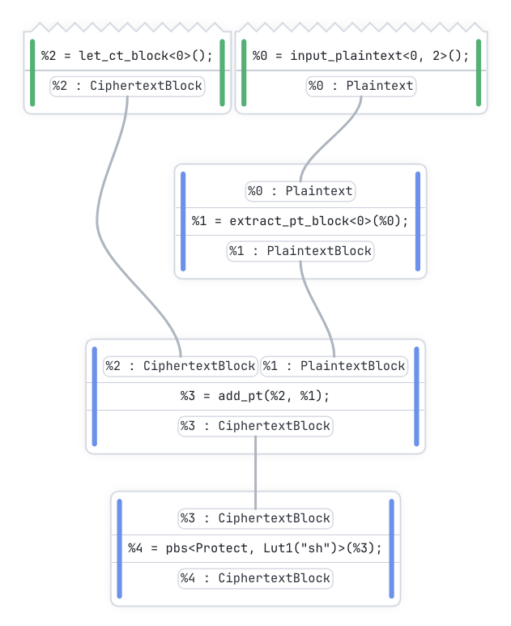
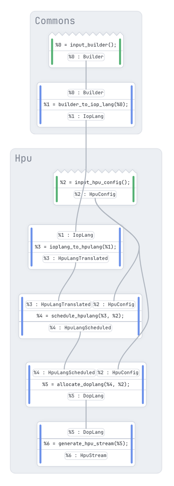
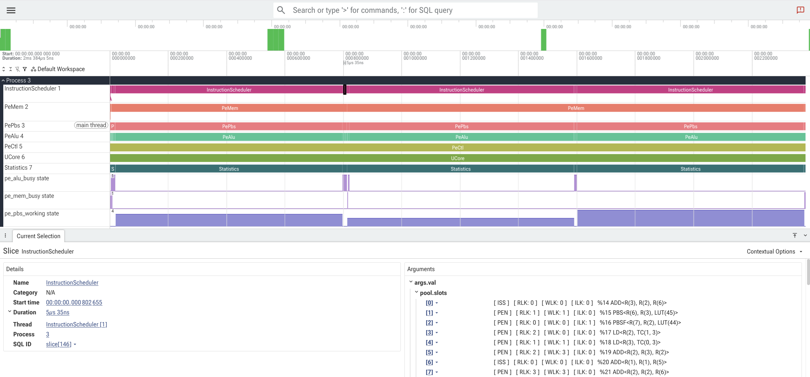

# A tour of ZHC

## Circuit Design

ZHC's main frontend is the Rust [`Builder`](https://docs.rs/zhc_builder/latest/zhc_builder/struct.Builder.html) object which can be used to programmatically build arithmetic circuits. It provides access to design-oriented features:



```rust
use zhc::prelude::*;

// 2 carry bits / 2 message bits
let bd = Builder::new(SpecBlock(2, 2));
let pti =  bd.plaintext_integer_input(2);
let pt =   bd.plaintext_integer_split(pti)[0];
let ct =   bd.block_let_ciphertext(0);
let trv =  bd.block_add_plaintext(ct, pt);
let sh =   bd.block_lookup(
                trv,
                Lut1::from_fn(
                    "sh",
                    *bd.spec(),
                    |e| e.protect_shr(1)
                )
           );

bd.draw().open().unwrap();
```

<br clear="right">

The [`draw`](https://docs.rs/zhc_builder/latest/zhc_builder/struct.Builder.html#method.draw) method renders the underlying intermediate representation to an interactive graph suitable for visual inspection. This graph can optionally be annotated with various information such as emulation values, noise level, etc.

The API exposed by the `Builder` object offers semantics tailored to the TFHE cryptosystem. For maximum expressivity and safety, operations are available in [different flavors](https://docs.rs/zhc_crypto/latest/zhc_crypto/integer_semantics/index.html) depending on how they treat the __padding bit__. To simplify the debugging without having to go through encryption/decryption cycles, the builder object exposes an emulation layer which performs an abstract interpretation of the program and annotates the intermediate values:

```rust
bd.interpret()                               // On stdout:
    .with_inputs([pti.make_value(3)])        // ╔═══════════════════════════════════
    .dump();                                 // ║ Interpretation for : [3_ptint]
                                             // ║───────────────────────────────────
                                             // ║ %0 = input_plaintext<0, 2>();
                                             // ║     %0 -> 11_ptint
                                             // ║ %1 = extract_pt_block<0>(%0);
                                             // ║     %1 -> 0_00_11_ptblock
                                             // ║ %2 = let_ct_block<0>();
                                             // ║     %2 -> 0_00_00_ctblock
                                             // ║ %3 = add_pt(%2, %1);
                                             // ║     %3 -> 0_00_11_ctblock
                                             // ║ %4 = pbs<Protect, Lut1("sh")>(%3);
                                             // ║     %4 -> 0_00_01_ctblock
                                             // ╚═══════════════════════════════════
```

<details>
<summary>More on correctness</summary>
<br>
    
The invariants of the semantics are checked during abstract interpretation. This is especially useful when using the [`Builder::test_random`](https://docs.rs/zhc_builder/latest/zhc_builder/struct.Builder.html#method.test_random) method, which emulates the circuit on random inputs against a plaintext oracle. It allows the users to check their implementation at the algorithm level. Since no crypto is used for this test, the circuit can be evaluated on a large number of inputs to verify its implementation.

</details>

<details>
<summary>More on noise</summary>
<br>

Noise management is a big part of implementing FHE algorithms. It grows through operator application, but must always stay within some bounds to ensure data are not corrupted. The [`Builder::dump_noise`](https://docs.rs/zhc_builder/latest/zhc_builder/struct.Builder.html#method.dump_noise) method performs a noise analysis and displays it in a suitable format:
```rust
bd.dump_noise();                        // On stdout:
                                        // ╔════════════════════════════════════════════
                                        // ║ Noise Analysis
                                        // ║────────────────────────────────────────────
                                        // ║ @0   |  %0 = input_plaintext<0, 2>();
                                        // ║      |      %0 -> ░░░░░░░░░░░░   0%
                                        // ║ @1   |  %1 = extract_pt_block<0>(%0);
                                        // ║      |      %1 -> ░░░░░░░░░░░░   0%
                                        // ║ @2   |  %2 = let_ct_block<0>();
                                        // ║      |      %2 -> ░░░░░░░░░░░░   0%
                                        // ║ @3   |  %3 = add_pt(%2, %1);
                                        // ║      |      %3 -> ░░░░░░░░░░░░   0%
                                        // ║ @4   |  %4 = pbs<Protect, Lut1("sh")>(%3);
                                        // ║      |      %4 -> ▓░░░░░░░░░░░   8% (fresh)
                                        // ╚════════════════════════════════════════════
```

Note that ZHC also checks the noise during compilation to ensure that noise-incorrect circuits can never reach the end of the pipeline and produce executable artifacts.

</details>

## Compilation



The compiler itself is managed via the [`Pipeline`](https://docs.rs/zhc_pipeline/latest/zhc_pipeline/struct.Pipeline.html) object. It provides a lazy, query-based compilation of all the artifacts, and is itself based on a [ZHC Dialect](../zhc_langs/src/pipelinelang/mod.rs). This mechanism ensures a single source of truth exists for every artifact derivation. The pipeline, restricted to the HPU backend, is represented on the left. 

Every intermediate artifact is cached inside the pipeline, and can be pulled for inspection with `get_*` methods. This makes for a faster debugging experience, and prevents artifacts from being recompiled when not strictly necessary. On the other hand, modifying a pipeline input has the immediate effect of invalidating every transitively dependent artifact, for a predictable user experience.

Here is an example of pulling the text assembly listing for HPU via [`Pipeline::get_hpu_assembly`](https://docs.rs/zhc_pipeline/latest/zhc_pipeline/struct.Pipeline.html#method.get_hpu_assembly) when compiling the 16-bit addition circuit:
```rust
let mut pl = Pipeline::new()
    .with_builder(bd)
    .with_hpu_config(Default::default());
pl.get_hpu_assembly().open().unwrap();
```

<br clear="left">

```text
; !preamble {
; [signature]
; (Ciphertext<16, 2, 2>, Ciphertext<16, 2, 2>) -> Ciphertext<16, 2, 2>
; [lut]
; ManyCarryMsg: [0, 1, 2, 3, 0, 1, 2, 3, 0, 0, 0, 0, 1, 1, 1, 1]
; ExtractPropGroup0: [0, 0, 0, 1, 2, 2, 2, 2, 0, 0, 0, 1, 2, 2, 2, 2]
; ...
; }
LD R0 TS[1].3
LD R1 TS[0].3
ADD R0 R1 R0
...
PBS R4 R3 PbsExtractPropGroup0
PBS_ML2 R6 R1 PbsManyCarryMsg
PBS R5 R2 PbsExtractPropGroup1
```


<details>
<summary>More on verification</summary>
<br>
    
Every pass of the pipeline (including scheduling and register allocation) is verified, on [_the complete IOP library_](../zhc_pipeline_correctness), for precisions ranging from 2 to 128 bits. The current approach used for verification is differential evaluation. For each circuit, the IRs before and after the pass are both emulated (each dialect having its own emulator) on a large number of inputs, and the results are asserted bitwise equal.

</details>

## Execution



HPU board / cluster may not be readily available for development, impairing the ability of designers to iterate on their algorithms. Fortunately, ZHC includes a discrete-event simulator of the HPU and HPU-cluster targets, which can be used to get an accurate estimation of the HPU behavior on the compiled streams. Even better, [Perfetto](https://perfetto.dev/) traces of the execution can be extracted from the simulator via the [`Pipeline::get_hpu_trace`](https://docs.rs/zhc_pipeline/latest/zhc_pipeline/struct.Pipeline.html#method.get_hpu_trace) method. 

<br clear="right">

For even faster feedback loops, simpler aggregate metrics can be accessed with [`Pipeline::get_hpu_metrics`](https://docs.rs/zhc_pipeline/latest/zhc_pipeline/struct.Pipeline.html#method.get_hpu_metrics). The simulated latency is decomposed into key components: the time an ideal schedule would spend bootstrapping, the time lost to under-filled batches, and the time the PBS execution unit spends waiting:

```rust
// For a 32-bit addition circuit.
pl.get_hpu_metrics().dump();
// On stdout:
// ╔══════════════════════════════════════════════════════════════════════════════
// ║ HPU Metrics
// ║──────────────────────────────────────────────────────────────────────────────
// ║   Latency          : 5089.18 µs
// ║     PBS ideal      : 3391.49 µs  (lower bound)
// ║     Batch overhead : 1413.17 µs  (under-filled batches)
// ║     Starvation     : 284.51 µs  (PE waiting for work)
// ║   Slot occupancy   : 66.7%
// ║   Timeout launches : 0 / 6 batches
// ║──────────────────────────────────────────────────────────────────────────────
// ║   Batch Size Histogram:
// ║      2 │░░░░░░░░░░░░░░░░░░░░░░░░░░░░░▒▓● (1)
// ║      6 │░░░░░░░░░░░░░░░░░░░░░░░░░░░░░▒▓● (1)
// ║      8 │░░░░░░░░░░░░░░░░░░░░░░░░░░░░░░░░░░░░░░░░░░░░░░░░░░░░░░░░░░░░░░▒▓● (2)
// ║     12 │░░░░░░░░░░░░░░░░░░░░░░░░░░░░░░░░░░░░░░░░░░░░░░░░░░░░░░░░░░░░░░▒▓● (2)
// ╚══════════════════════════════════════════════════════════════════════════════
```

FHE is special for its large imbalance in operation latency: the ratio of __pbs__ to __linear__ operations runtimes (the two broad categories) can be in the hundreds to thousands. Approaches assuming homogeneous latencies are either unsuitable in this regime, or plainly inapplicable depending on the target. All platforms bring a different solution to this problem. All with a different set of constraints and challenges. To ensure peak performance can be reached for every target, each one is the target of a separate branch of the backend.

<details>
<summary>More on HPU scheduling</summary>
<br>

As seen in the assembly shown above, HPU follows a standard processor architecture with ciphertext register file, dedicated processing elements, and accompanying ciphertext-level ISA. PBS processing is particular in that it operates on batches of ciphertexts, with a latency almost independent of the batch size. Our scheduler mixes as-late-as-possible list-scheduling with a lightweight simulation, to both schedule and batch PBS operations together in one pass.

</details>

<details>
<summary>More on Multi-HPU</summary>
<br>

To throw more compute power at a circuit, HPUs can be interconnected into a cluster, allowing fast transfers of ciphertexts between boards. Large computations can then be spread over more processing elements, lowering the execution latency. Thanks to an automatic partitioning mechanism, no manual intervention is needed to balance the workload over the boards.

ZHC's task-level parallelism framework coarsens the [`IopLang`](https://docs.rs/zhc_langs/latest/zhc_langs/ioplang/index.html) circuit into a PBS task graph. This DAG of tasks is then mapped onto the cluster, accounting for the dependencies, the locality of the data and the preferred concentration of work. This mapping is materialized back into `IopLang` with explicit transfers between boards, and replication of work where it makes sense.

</details>

<details>
<summary>More on CPU</summary>
<br>

CPU machines (multi-sockets and laptops alike) can be targeted by ZHC via the `zhc_vm` crate. It offers a topology-aware multi-threaded virtual machine for a custom FHE bytecode. Requiring no other dependency than `tfhe-rs` for the implementation of the cryptographic operators, `zhc_vm` is a small, self-contained runtime built for maximum performance.

ZHC leverages its task-level parallelism framework to derive a [`VmExecutionPlan`](https://docs.rs/zhc_pipeline/latest/zhc_pipeline/struct.VmExecutionPlan.html): a static schedule of the bytecode executed by every thread of the machine, plus a lock table ensuring the safety of the execution. Nothing is decided at runtime, which removes the overhead and complexity of the dynamic work-stealing schedulers commonly used.

</details>
